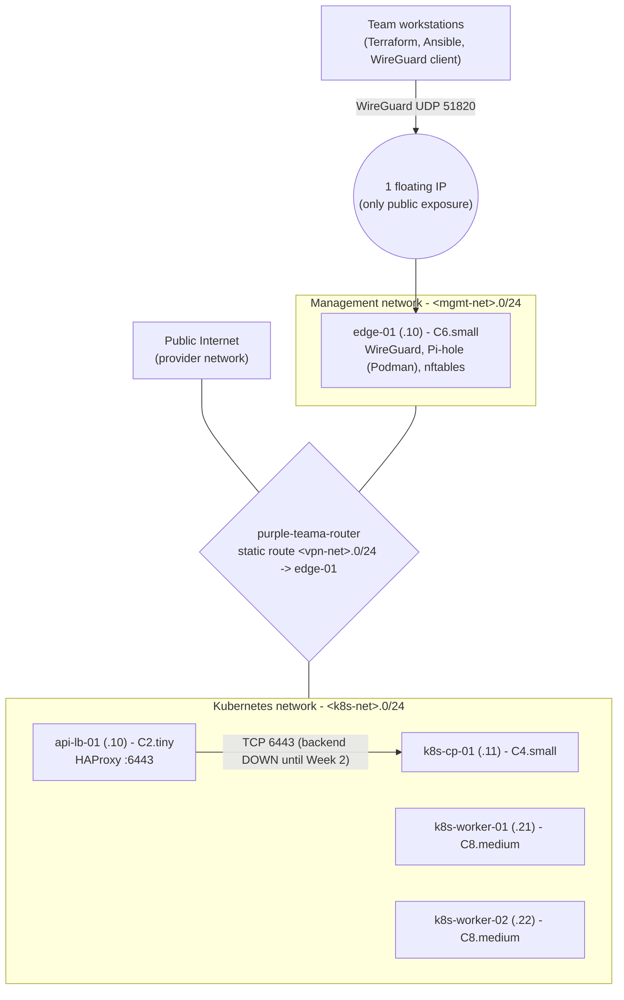

# Week 1 architecture and trust path

| Layer | Allowed in | Owner |
| --- | --- | --- |
| Security group `purple-teama-edge` | UDP 51820 only (temporary SSH /32 removed at step 22) | Terraform |
| Security group `purple-teama-internal` | all traffic from the three team ranges | Terraform |
| edge-01 nftables (`inet edge_filter`) | WireGuard; SSH from team ranges; DNS/Pi-hole UI to the container from team ranges; VPN forwarding to team networks | Ansible `firewall` role |
| DNS | subnets hand out Pi-hole (edge-01) then a public fallback | Terraform (subnet) + Ansible (`common` role) |
